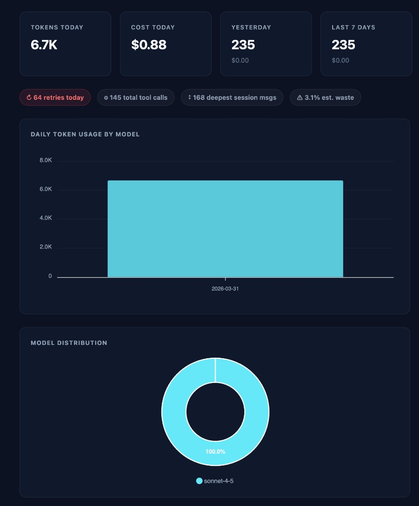
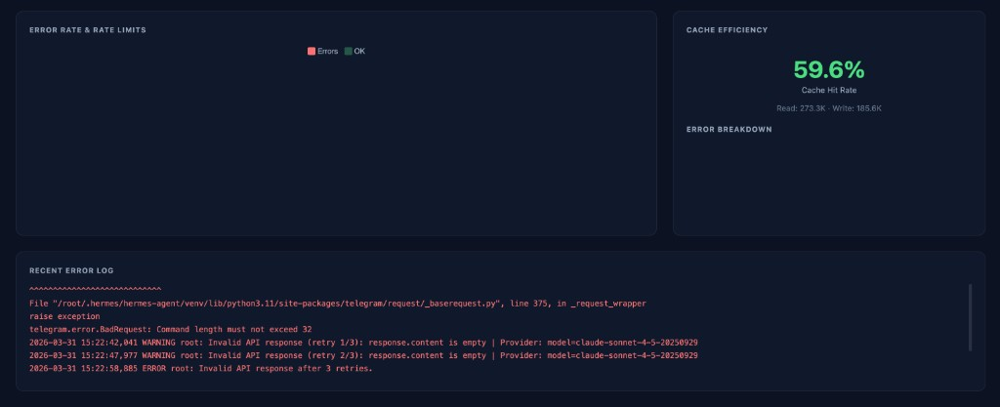
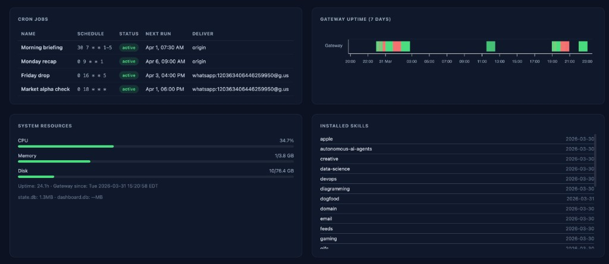
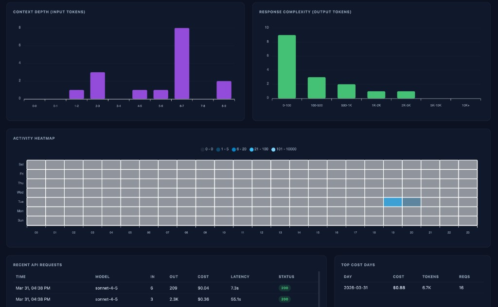
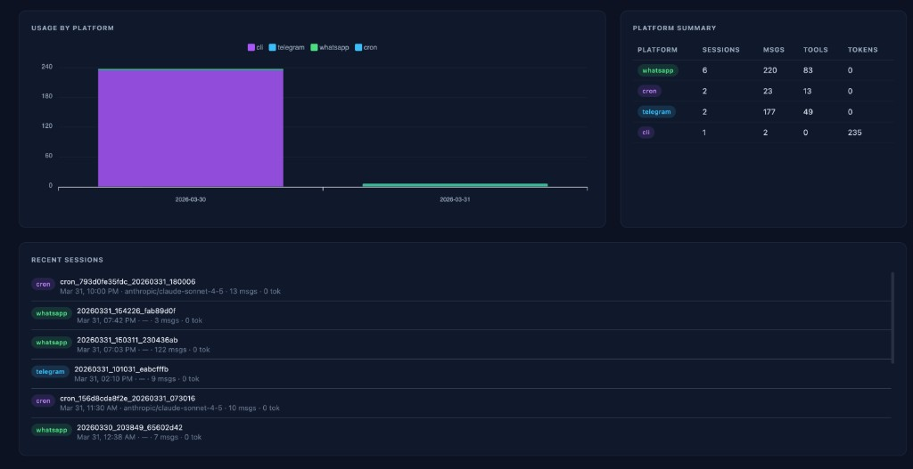
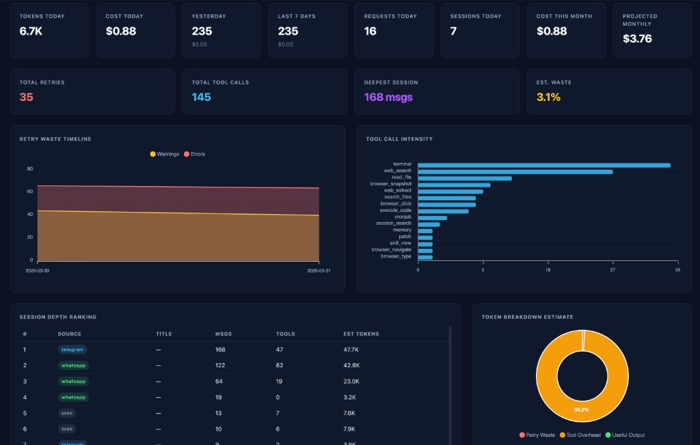
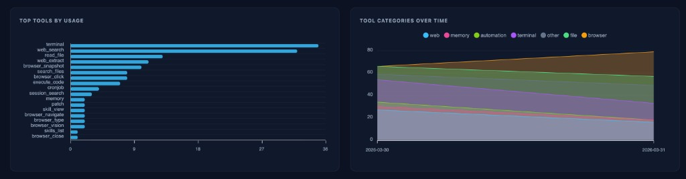
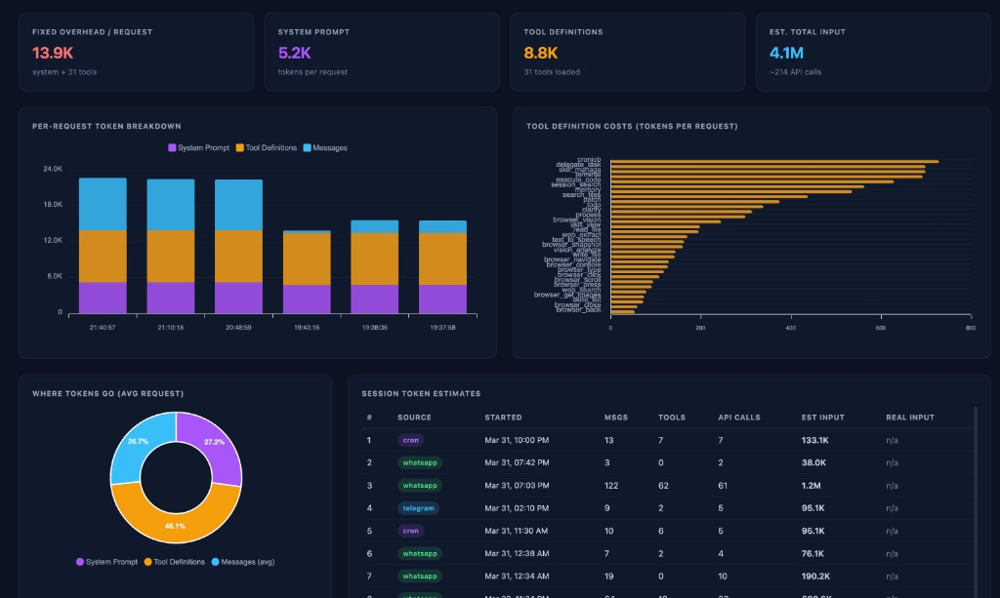

# Hermes Agent Dashboard

Analytics and cost-monitoring dashboard for [Hermes Agent](https://github.com/NousResearch/hermes-agent) (Aria). Provides real-time visibility into API token consumption, cost breakdowns by model and platform, tool usage analytics, conversation depth analysis, error tracking, cron job monitoring, and system health — all behind HTTPS with secret-code authentication.

```
┌──────────────────────────────────────────────────────────────────┐
│  Browser (any device)                                           │
│  https://dashboard.your-domain.com                              │
└───────────────────────────┬──────────────────────────────────────┘
                            │ HTTPS (Let's Encrypt)
┌───────────────────────────▼──────────────────────────────────────┐
│  DigitalOcean VPS (YOUR_SERVER_IP)                               │
│                                                                  │
│  ┌─────────────┐    ┌─────────────────────────────────────────┐  │
│  │   Caddy      │───▶│  Dashboard App (FastAPI :3333)          │  │
│  │   :443       │    │  ┌───────────┐  ┌───────────────────┐  │  │
│  └─────────────┘    │  │ Auth      │  │ Analytics API     │  │  │
│                      │  └───────────┘  └───────────────────┘  │  │
│  ┌─────────────┐    │  ┌───────────┐  ┌───────────────────┐  │  │
│  │   Hermes     │───▶│  │ API Proxy │  │ State DB Reader   │  │  │
│  │   Gateway    │    │  └─────┬─────┘  └────────┬──────────┘  │  │
│  └─────────────┘    └────────┼──────────────────┼─────────────┘  │
│                              │                  │                 │
│                   ┌──────────▼────┐   ┌─────────▼──────────┐     │
│                   │ dashboard.db  │   │ ~/.hermes/state.db │     │
│                   │ (proxy logs)  │   │ (sessions, tools)  │     │
│                   └───────────────┘   └────────────────────┘     │
│                              │                                    │
└──────────────────────────────┼────────────────────────────────────┘
                               │ Forward
                   ┌───────────▼───────────┐
                   │  Anthropic API         │
                   │  api.anthropic.com     │
                   └───────────────────────┘
```

---

## Screenshots

### Overview — KPIs, Daily Usage, Model Distribution


### Token Analysis — Retry Waste, Tool Intensity, Session Depth


### Token Forensics — Per-Request Breakdown, Tool Definition Costs


### Usage — Context Depth, Response Complexity, Activity Heatmap


### Platforms — Per-Gateway Breakdown, Recent Sessions


### Tools — Usage Ranking, Category Trends


### Reliability — Error Rates, Cache Efficiency, Error Log


### Operations — Cron Jobs, Gateway Uptime, System Resources, Skills


---

## How It Works

The dashboard sits between Hermes and the Anthropic API as a **transparent proxy**. Hermes sends API requests to `localhost:3333` instead of `api.anthropic.com`. The proxy forwards every request unchanged, captures the response (including streaming SSE), and logs usage data to a local SQLite database. Hermes doesn't notice any difference.

In addition to proxy data, the dashboard reads Hermes's own **state.db** (read-only) — which already contains sessions tagged by platform (Telegram, WhatsApp, CLI, Discord, Slack), full message history with tool call details, token counts, and model information.

Together these two data sources power all dashboard panels.

---

## Dashboard Panels

### KPI Strip
- Tokens today, Cost today, Requests today, Sessions today
- Cost this month, Projected monthly cost
- Cost alert banner when configurable thresholds are exceeded

### Token Usage & Cost
- **Daily Token Usage** — Stacked bar chart by model (last 30 days)
- **Daily Cost Trend** — Line chart by model

### Platform Analytics
- **Usage by Platform** — Stacked bar (Telegram / WhatsApp / CLI / Discord / Slack)
- **Platform Summary** — Table with session count and unique users per platform

### Tool Usage Analytics
- **Top Tools by Usage** — Horizontal bar chart of the 15 most-used tools (terminal, web_search, read_file, memory, etc.)
- **Tool Categories Over Time** — Stacked area chart showing trends by category (web, terminal, file, browser, memory, orchestration, automation)

### Conversation Depth
- **Context Depth** — Histogram of input token counts per request (reveals how deep conversations get before compression)
- **Response Complexity** — Output token distribution histogram (short replies vs long-form responses)

### Model Distribution
- **Model Distribution** — Donut chart showing token share across models
- **Activity Heatmap** — Hour x day-of-week grid showing when Aria is most active

### Error Tracking
- **Error Rate & Rate Limits** — Stacked bar of errors vs successful requests per day
- **Error Breakdown** — Table of HTTP status codes (429 rate limits, 529 overloaded, etc.)

### Cache Efficiency
- **Cache Hit Rate** — Percentage of cache-read vs cache-write tokens (higher = better prompt caching)

### Request Log & Cost
- **Recent API Requests** — Scrollable table with timestamp, model, tokens in/out, cost, latency, status
- **Top Cost Days** — Ranked list of most expensive days

### Cron Job Monitor
- **Active Cron Jobs** — Table parsed from `hermes cron list`

### System Health
- **Gateway Status** — Active/inactive badge with uptime
- **System Resources** — CPU, RAM, and disk usage gauges
- **Gateway Uptime Timeline** — Gantt-style bar from journalctl (green=up, red=down)
- **Database Sizes** — state.db and dashboard.db file sizes
- **Installed Skills** — List from `~/.hermes/skills/`
- **Recent Sessions** — Latest sessions with title, platform, model, and timestamp
- **Recent Errors** — Tail of `~/.hermes/logs/errors.log`

---

## Prerequisites

- **DigitalOcean droplet** (or any VPS) running Hermes Agent with Python 3.11+ and systemd
- **Domain name** with DNS A record pointing to the server IP (e.g. `dashboard.your-domain.com → YOUR_SERVER_IP`)
- **SSH access** to the server as root

---

## Quick Start

### 1. Set up DNS

Add an A record at your domain registrar:

```
dashboard.your-domain.com  →  YOUR_SERVER_IP
```

Allow a few minutes for DNS propagation.

### 2. Deploy

From your **local machine** (not the server), run:

```bash
cd dashboard/
./deploy.sh your-secret-code-here
```

This single command will:
1. Upload all files to `/root/hermes-dashboard/` on the server
2. Create a Python virtual environment and install dependencies
3. Set `DASHBOARD_SECRET` in the server's `.env`
4. Install Caddy (if not already installed) and configure HTTPS
5. Open ports 80 (Let's Encrypt challenge) and 443 (HTTPS) in the firewall
6. Install and start the `hermes-dashboard` systemd service
7. Add `ANTHROPIC_BASE_URL=http://localhost:3333` to Hermes's `.env`
8. Restart the Hermes gateway to route API calls through the proxy

### 3. Access

Open `https://dashboard.your-domain.com` and enter your secret code.

---

## Manual Installation

If you prefer to set up each component manually:

```bash
# SSH into the server
ssh root@YOUR_SERVER_IP

# Upload files (from local machine)
rsync -avz --exclude='venv' --exclude='*.db' --exclude='.env' dashboard/ root@YOUR_SERVER_IP:/root/hermes-dashboard/

# On the server:
cd /root/hermes-dashboard

# Python environment
python3.11 -m venv venv
venv/bin/pip install -r requirements.txt

# Configuration
cp .env.example .env
nano .env  # Set DASHBOARD_SECRET to a strong value

# Install Caddy
# See https://caddyserver.com/docs/install#debian-ubuntu-raspbian
apt install -y caddy
cp Caddyfile /etc/caddy/Caddyfile
mkdir -p /var/log/caddy

# Firewall
ufw allow 80/tcp
ufw allow 443/tcp

# Systemd service
cp hermes-dashboard.service /etc/systemd/system/
systemctl daemon-reload
systemctl enable --now hermes-dashboard

# Start Caddy
systemctl restart caddy

# Configure Hermes to use proxy
echo "ANTHROPIC_BASE_URL=http://localhost:3333" >> ~/.hermes/.env
systemctl restart hermes-gateway
```

---

## Configuration

All configuration is done through environment variables in `/root/hermes-dashboard/.env`:

| Variable | Default | Description |
|---|---|---|
| `DASHBOARD_SECRET` | *(required)* | Secret code for dashboard login |
| `HERMES_HOME` | `/root/.hermes` | Path to Hermes data directory |
| `DASHBOARD_DB` | `./dashboard.db` | Path to the proxy's SQLite database |
| `ALERT_DAILY_USD` | `25` | Daily cost alert threshold (USD). Set to `0` to disable |
| `ALERT_WEEKLY_USD` | `100` | Weekly cost alert threshold |
| `ALERT_MONTHLY_USD` | `300` | Monthly cost alert threshold |
| `SESSION_TTL_DAYS` | `7` | How long the login session cookie stays valid |

---

## Model Pricing

The cost calculation engine uses a built-in pricing table in `app/pricing.py`. Current prices:

| Model | Input (per 1M tokens) | Output (per 1M tokens) |
|---|---|---|
| Claude Haiku 3.5 | $1.00 | $5.00 |
| Claude Sonnet 3.5 / 4 | $3.00 | $15.00 |
| Claude Opus 4 | $15.00 | $75.00 |

Cache write tokens: 1.25x input price. Cache read tokens: 0.1x input price.

To update prices, edit the `PRICING` dictionary in `app/pricing.py` and restart the service. Unknown models default to Sonnet pricing.

---

## Security

| Layer | Protection |
|---|---|
| **HTTPS** | Caddy auto-provisions Let's Encrypt certificates. HTTP redirects to HTTPS. Security headers (HSTS, X-Frame-Options, etc.) are set in the Caddyfile. |
| **Authentication** | Secret code hashed with constant-time comparison. Session maintained via signed cookie (`itsdangerous`). Configurable TTL. |
| **Network** | FastAPI binds to `127.0.0.1:3333` only — not reachable from the internet. Only Caddy (443) and Hermes (localhost) can connect. Port 3333 is never opened in the firewall. |
| **Database** | SQLite files are stored under `/root/` (readable only by root). `state.db` is opened in read-only mode. |
| **API Keys** | The proxy forwards the `x-api-key` header to Anthropic and never persists it to disk or logs. |
| **Firewall** | Only ports 22 (SSH), 80 (ACME challenge), and 443 (HTTPS) are open. |

---

## File Structure

```
dashboard/
├── app/
│   ├── __init__.py
│   ├── main.py            # FastAPI app: routes, middleware, API endpoints
│   ├── proxy.py           # Transparent Anthropic API proxy (SSE + JSON)
│   ├── auth.py            # Secret-code login, session cookies, middleware
│   ├── database.py        # dashboard.db (read-write) + state.db (read-only)
│   ├── analytics.py       # 15 aggregation query functions
│   ├── system_health.py   # CPU/RAM/disk, systemd, journalctl, skills, cron
│   ├── pricing.py         # Model pricing table + cost calculator
│   └── config.py          # Environment variable loading
├── static/
│   ├── app.js             # Frontend: 19 chart/data functions, ApexCharts
│   └── style.css          # Dark theme, cards, gauges, tables
├── templates/
│   ├── index.html         # Dashboard page (9 sections, 20+ panels)
│   └── login.html         # Login page
├── .env.example           # Configuration template
├── requirements.txt       # Python dependencies
├── Caddyfile              # HTTPS reverse proxy config
├── hermes-dashboard.service  # systemd unit file
├── deploy.sh              # One-command deployment script
└── README.md              # This file
```

---

## API Endpoints

All endpoints require authentication (session cookie) except `/health` and `/v1/*` (proxy).

| Endpoint | Description |
|---|---|
| `GET /health` | Health check (returns `{"status": "ok"}`) |
| `GET /` | Dashboard page |
| `GET /login` | Login page |
| `POST /login` | Submit secret code |
| `GET /logout` | Clear session and redirect to login |
| `POST /v1/messages` | Anthropic API proxy (transparent) |
| `GET /api/kpis` | KPI card data (tokens, cost, requests, sessions, alerts) |
| `GET /api/daily-usage?days=30` | Daily token usage by model |
| `GET /api/daily-cost?days=30` | Daily cost by model |
| `GET /api/platform-usage?days=30` | Usage by platform (from state.db) |
| `GET /api/platform-summary?days=30` | Platform summary table |
| `GET /api/tool-usage?days=30` | Top tools by invocation count |
| `GET /api/tool-usage-timeline?days=30` | Tool categories over time |
| `GET /api/model-distribution?days=30` | Token/cost/request distribution by model |
| `GET /api/hourly-heatmap?days=30` | Activity by hour and day of week |
| `GET /api/context-depth?days=30` | Input token histogram + average over time |
| `GET /api/output-distribution?days=30` | Output token distribution brackets |
| `GET /api/errors?days=30` | Error rate, recent errors, status code breakdown |
| `GET /api/recent-requests?limit=100` | Recent API request log |
| `GET /api/top-cost-days?limit=10` | Most expensive days ranked |
| `GET /api/cache-efficiency?days=30` | Cache read/write tokens and hit rate |
| `GET /api/recent-sessions?limit=20` | Recent sessions from state.db |
| `GET /api/system-health` | CPU, RAM, disk, gateway status, skills, errors |
| `GET /api/uptime-timeline?hours=168` | Gateway start/stop events from journalctl |
| `GET /api/cron-jobs` | Active cron jobs from `hermes cron list` |

All `?days=` and `?limit=` parameters are optional with the defaults shown above.

---

## Operations

### Check service status

```bash
ssh root@YOUR_SERVER_IP

systemctl status hermes-dashboard   # Dashboard app
systemctl status caddy              # HTTPS proxy
systemctl status hermes-gateway     # Hermes agent
```

### View logs

```bash
# Dashboard app logs
journalctl -u hermes-dashboard -f

# Caddy access logs
tail -f /var/log/caddy/dashboard.log

# Hermes gateway logs
journalctl -u hermes-gateway -f
```

### Restart services

```bash
systemctl restart hermes-dashboard  # After config changes
systemctl restart caddy             # After Caddyfile changes
systemctl restart hermes-gateway    # After Hermes .env changes
```

### Update the dashboard

From your local machine:

```bash
cd dashboard/
./deploy.sh
```

This re-uploads files and restarts services. Your `.env` and `dashboard.db` on the server are preserved (excluded from rsync).

### Change the access code

```bash
ssh root@YOUR_SERVER_IP
nano /root/hermes-dashboard/.env     # Change DASHBOARD_SECRET
systemctl restart hermes-dashboard
```

All existing sessions will be invalidated (the cookie signature changes).

### Adjust cost alerts

```bash
ssh root@YOUR_SERVER_IP
nano /root/hermes-dashboard/.env     # Change ALERT_*_USD values
systemctl restart hermes-dashboard
```

### Add a new model to the pricing table

Edit `app/pricing.py` on your local machine, add the model entry to the `PRICING` dictionary, and redeploy:

```bash
./deploy.sh
```

### Back up the database

```bash
ssh root@YOUR_SERVER_IP "sqlite3 /root/hermes-dashboard/dashboard.db '.backup /tmp/dashboard-backup.db'"
scp root@YOUR_SERVER_IP:/tmp/dashboard-backup.db ./
```

---

## Troubleshooting

| Problem | Solution |
|---|---|
| Dashboard shows "502 Bad Gateway" | Check if FastAPI is running: `systemctl status hermes-dashboard`. Check logs: `journalctl -u hermes-dashboard --since "5 min ago"` |
| HTTPS certificate not provisioning | Verify DNS A record resolves: `dig dashboard.your-domain.com`. Ensure ports 80 and 443 are open: `ufw status`. Check Caddy logs: `journalctl -u caddy -f` |
| Login page doesn't accept the code | Verify `DASHBOARD_SECRET` in `.env` matches what you're typing. Restart: `systemctl restart hermes-dashboard` |
| Charts show no data | Data accumulates from when the proxy starts. If Hermes was recently restarted with the new `ANTHROPIC_BASE_URL`, send a message to Aria and check again |
| Platform/tool panels say "no data" | These panels read from `~/.hermes/state.db`. Ensure `HERMES_HOME` in `.env` points to the correct path. The file must exist and be readable |
| Hermes stops responding | Check if the dashboard proxy is running: `curl http://localhost:3333/health`. If down, Hermes can't reach Anthropic. Restart: `systemctl restart hermes-dashboard` |
| Hermes errors after enabling proxy | To revert, remove `ANTHROPIC_BASE_URL` from `~/.hermes/.env` and restart: `systemctl restart hermes-gateway` |
| High memory usage | The dashboard is capped at 512MB via systemd `MemoryMax`. If SQLite grows large, consider pruning old Hermes sessions: `hermes sessions prune --older-than 90` |
| Database locked errors | Both databases use WAL mode for concurrent access. If persistent, restart: `systemctl restart hermes-dashboard` |

### Emergency: Disable the proxy

If the dashboard proxy causes issues with Hermes, remove it immediately:

```bash
ssh root@YOUR_SERVER_IP
sed -i '/ANTHROPIC_BASE_URL/d' ~/.hermes/.env
systemctl restart hermes-gateway
```

Hermes will revert to calling `api.anthropic.com` directly. The dashboard will stop collecting new data but remains accessible with historical data.

---

## Data Flow

```
1. User sends message to Aria via Telegram/WhatsApp/CLI

2. Hermes Gateway processes the message and prepares an API call

3. Hermes SDK sends POST to http://localhost:3333/v1/messages
   (instead of https://api.anthropic.com/v1/messages)

4. Dashboard proxy:
   a. Forwards the request to api.anthropic.com
   b. Receives the response (streaming SSE or JSON)
   c. Extracts: model, input_tokens, output_tokens, cache tokens,
      stop_reason, latency, status_code
   d. Calculates cost using the pricing table
   e. Logs everything to dashboard.db
   f. Returns the response unchanged to Hermes

5. Hermes processes the response and replies to the user

6. Meanwhile, Hermes also writes session metadata to state.db:
   session ID, source platform, user_id, model, title,
   messages with tool_calls, token counts

7. Dashboard reads both databases to render analytics
```

---

## Tech Stack

| Component | Technology | Why |
|---|---|---|
| Backend | Python 3.11, FastAPI, uvicorn | Async, lightweight, already on the server |
| Database | SQLite (WAL mode) | Zero setup, single-writer sufficient for one agent |
| Proxy | httpx (async) | Full streaming SSE support |
| Auth | itsdangerous, hmac | Signed cookies, constant-time comparison |
| Frontend | Vanilla JS, ApexCharts | No build step, no npm, CDN-delivered |
| CSS | Tailwind CSS (Play CDN) | Dark theme utilities, no build step |
| HTTPS | Caddy | Automatic Let's Encrypt, zero config |
| Process | systemd | Already used for Hermes, reliable restarts |

---

*Version 1.0 — March 31, 2026*
